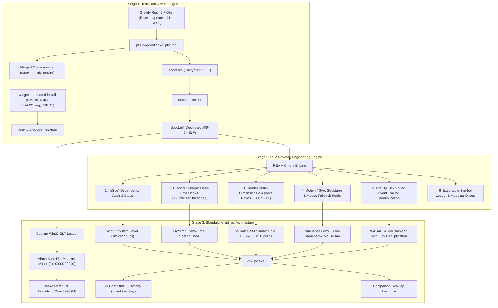

# Gravity Rush 2 Native PC Port (`gr2_pc`) Master Implementation Plan

## Goal Description
Reverse engineer **Gravity Rush 2 (PS4)** from its game package (Base Game + Update v1.11 + DLCs), extract and analyze its compiled x86-64 binary (`eboot.bin` $\rightarrow$ `eboot.elf`) using **REA** and **Ghidra**, and build a high-performance standalone native Windows PC port (`gr2_pc`).

Following the proven engineering architecture of **`bloodborne_pc` (`bbport`)** and **`FelipePrado0/gow3_pc`**, this project executes the original x86-64 game code natively on PC CPUs, coupled with a Win32 flat memory manager, a Vulkan GNM/GNMX shader translation core (derived from the open-source headless shadPS4 engine), a hybrid launcher + in-game ImGui overlay, and custom patches for:
- **Dynamic physics delta-time scaling** supporting 60, 120, 144 FPS and uncapped refresh rates.
- **Selectable native internal resolutions** (1080p, 1440p, 4K) with FSR 3 / DLSS temporal upscaling and RCAS sharpening.
- **Xbox controller motion fallback** allowing precise mouse-directed gravity shift aiming while keeping standard gamepad movement.
- **Comprehensive REA reverse engineering** producing exportable symbol ledgers, camera/FOV hooks, and audio bug fixes.

---

## Architectural Blueprint



---

## Technical Specifications & User Decisions

### 1. Motion & Controller Scheme
* **DualSense / DualShock 4:** Native hardware gyroscope read via SDL3 / Hidapi, mapped directly to `libScePad` motion vectors.
* **Xbox Gamepad (No Gyro):** Standard movement and buttons are mapped to the Xbox controller. When entering Gravity Shift aiming, mouse motion is captured and translated into `ScePadData.motionData` angular velocity, providing high-precision PC mouse aiming.

### 2. High Framerate & Physics Engine
* **Dynamic $\Delta t$ Timestep Scaling:** Instead of a rigid frame multiplier, the game's internal frame clock routine will be hooked to compute elapsed time dynamically:
  $$\Delta t = \min\left(\text{frame\_delta\_seconds}, \frac{1}{30.0}\right)$$
* **Configurable FPS Limiter:** Toggleable inside the ImGui overlay:
  - **60 FPS** (standard physics parity)
  - **120 FPS** (high refresh rate)
  - **144 FPS** (esports display standard)
  - **Uncapped** (variable refresh rate / G-Sync / FreeSync)

### 3. Resolution & Graphics Pipeline
* **Selectable Render Targets:** 1080p ($1920\times 1080$), 1440p ($2560\times 1440$), and 4K ($3840\times 2160$) with aspect ratio correction hooks for Ultrawide ($21:9$ / $32:9$).
* **Upscalers & Sharpening:** AMD FSR 3 / NVIDIA DLSS integration with Contrast-Adaptive Sharpening (RCAS) adjustable via slider.
* **Vulkan Driver Optimizations:** Custom memory allocations and `readbackLinearImages = false` to eliminate shadow flickering and cell-shading artifacts on NVIDIA RTX 4060 Ti hardware.

### 4. UI Architecture (Hybrid)
* **Desktop Companion Launcher:** Lightweight native window to configure initial resolution, display monitor, window mode (Borderless / Fullscreen / Windowed), and audio device before launch.
* **In-Game ImGui Overlay:** Toggled in real-time with `Insert` (or Controller `Start + Select`) to adjust framerate limits, upscaling sliders, mouse sensitivity, and performance metrics (FPS, frame times, VRAM).

---

## Detailed Implementation Breakdown

### Phase 1: Toolchain & Dependency Provisioning
Automated winget installation of all necessary development and analysis packages:

```powershell
# 1. Install C++ Build Tools & Build System
winget install Kitware.CMake --silent --accept-package-agreements --accept-source-agreements
winget install Ninja-build.Ninja --silent --accept-package-agreements --accept-source-agreements
winget install LLVM.LLVM --silent --accept-package-agreements --accept-source-agreements

# 2. Install JDK 21 for Ghidra
winget install Microsoft.OpenJDK.21 --silent --accept-package-agreements --accept-source-agreements

# 3. Setup Ghidra and configure REA environment
# Set GHIDRA_INSTALL_DIR pointing to extracted Ghidra release
```

---

### Phase 2: Ingestion & Extraction Pipeline
A dedicated workspace layout in `C:\Users\faalv\Desktop\Personal project\gravityrush2port`:

```
gravityrush2port/
├── gr2_packages/                 <-- User places PKG files here (outside git)
│   ├── GravityRush2_Base.pkg
│   ├── GravityRush2_Update_v1.11.pkg
│   └── DLCs/
├── REA/                          <-- REA engine & analysis toolchain (outside git)
└── gr2port/                      <-- Standalone Git Repository (Auto-pushed to GitHub)
    ├── .git/
    ├── .gitignore
    ├── README.md
    ├── log.md
    ├── CMakeLists.txt
    ├── src/
    ├── include/
    └── workspace/
        ├── extracted_base/
        ├── extracted_update/
        └── merged_game/          <-- Merged final assets
            ├── sce_sys/
            ├── data/
            ├── sound/
            ├── movie/
            └── eboot.elf         <-- Decrypted x86-64 target
```

1. **Extraction Script:** Automated extraction of base game assets, followed by applying the v1.11 delta files on top of base game files.
2. **Decryption:** Decrypt `eboot.bin` to `eboot.elf`.
3. **Integrity Verification:** Compute SHA-256 and confirm ELF header integrity (`ELF64`, System V AMD64, relocatable).

---

### Phase 3: Binary Reverse Engineering with REA & Ghidra

Using REA's CLI and MCP toolchain, we inspect the decrypted `eboot.elf`:

#### 1. System API Import Audit
```powershell
rea analyze "workspace/merged_game/eboot.elf" --provider ghidra --json > gr2-analysis.json
```
Verify complete import lists for:
- `libScePad` (`scePadOpen`, `scePadReadState`, `scePadSetLightBar`)
- `libSceAudioOut` (`sceAudioOutOpen`, `sceAudioOutOutput`)
- `libSceFios2` (virtual filesystem lookups)
- `libSceSaveData` (profile & save operations)
- `libSceGnmDriver` (command buffers & GPU memory)

#### 2. Clock & Dynamic Delta-Time Reverse Engineering
- Decompile the main frame step function using REA:
  ```powershell
  rea decompile "workspace/merged_game/eboot.elf" <address> --provider ghidra --json
  ```
- Locate the hardcoded $1/30$ ($0.033333335\text{f}$) timestep constant.
- Prepare inline hook signatures to replace the static constant with our dynamic delta variable.

#### 3. Motion Gyro & Mouse Input Mapping
- Cross-reference `scePadReadState`:
  ```powershell
  rea xrefs "workspace/merged_game/eboot.elf" "scePadReadState" --provider ghidra --json
  ```
- Identify the memory buffer where `motionData` (yaw, pitch, roll velocities) is written into Kat's orientation matrix.
- Hook this structure so that relative mouse movement directly populates these angular values.

#### 4. Audio Bug Trace
- Trace audio cue triggers for Kat's gravity kick.
- Build a deduplication filter hook in `gr2_audio.cpp` to prevent overlapping kick sound playback.

#### 5. Comprehensive Documentation Ledger
- Generate a full symbol inventory and function offset map exported into `docs/gr2_symbol_ledger.json`.

---

### Phase 4: Standalone PC Runner Implementation (`gr2_pc`)

Project structure:

```
gr2_pc/
├── CMakeLists.txt
├── include/
│   ├── gr2_config.h
│   ├── gr2_memory.h
│   ├── gr2_loader.h
│   ├── gr2_hooks.h
│   ├── gr2_pad.h
│   ├── gr2_audio.h
│   └── gr2_overlay.h
├── src/
│   ├── main.cpp
│   ├── gr2_memory.cpp          # Win32 VirtualAlloc 64-bit mirror
│   ├── gr2_loader.cpp          # ELF segment loader & dynamic relocation
│   ├── gr2_hooks.cpp           # Delta-time, resolution & audio patches
│   ├── gr2_pad.cpp             # Gamepad + Mouse gyro emulation
│   ├── gr2_audio.cpp           # WASAPI output & kick fix
│   └── gr2_config.cpp          # Config file parsing
├── gpu/
│   ├── CMakeLists.txt
│   ├── vulkan_backend.cpp      # Vulkan 1.3 swapchain & pipeline
│   ├── gnm_translator.cpp      # GNM/GNMX to SPIR-V translation
│   └── upscalers.cpp           # FSR 3 / DLSS / RCAS integration
├── ui/
│   ├── imgui_overlay.cpp       # In-game menu overlay (Insert)
│   └── launcher_gui.cpp        # Companion desktop startup launcher
└── patches/
    ├── dynamic_fps.patch
    ├── ultrawide_aspect.patch
    └── shadow_fix.patch
```

#### Core Code Implementations

##### A. Memory Virtualization (`gr2_memory.cpp`)
```cpp
#include <windows.h>
#include <cstdint>
#include <stdexcept>

void* allocate_ps4_virtual_memory() {
    // Mirror PS4 64-bit flat address space at fixed virtual address
    void* base = VirtualAlloc(
        (void*)0x10000000000ULL,
        0x800000000ULL, // 32 GB address window
        MEM_RESERVE | MEM_COMMIT,
        PAGE_EXECUTE_READWRITE
    );
    if (!base) {
        throw std::runtime_error("Failed to allocate virtual memory mirror");
    }
    return base;
}
```

##### B. Dynamic Delta-Time Hook (`gr2_hooks.cpp`)
```cpp
#include "gr2_hooks.h"
#include <algorithm>

static float g_target_max_fps = 144.0f;
static float g_current_delta_time = 1.0f / 60.0f;

extern "C" float hook_get_delta_time(float original_dt) {
    // Enforce dynamic timestep scaling bounded by minimum stable interval
    float dynamic_dt = std::min(g_current_delta_time, 1.0f / 30.0f);
    return dynamic_dt;
}

void install_timing_hook(uintptr_t base_address, uintptr_t delta_time_offset) {
    // Write jump detour to hook_get_delta_time
    patch_call(base_address + delta_time_offset, (void*)&hook_get_delta_time);
}
```

##### C. Gamepad & Mouse Gyro Hook (`gr2_pad.cpp`)
```cpp
#include "gr2_pad.h"
#include <SDL3/SDL.h>

struct ScePadMotionData {
    float accX, accY, accZ;
    float gyroX, gyroY, gyroZ;
};

void update_pad_motion(ScePadMotionData* motion, bool has_native_gyro) {
    if (has_native_gyro) {
        // Read directly from DualSense hardware gyro
        return;
    }
    
    // Xbox Gamepad Fallback: Read relative mouse delta
    float mouse_dx = 0.0f, mouse_dy = 0.0f;
    SDL_GetRelativeMouseState(&mouse_dx, &mouse_dy);
    
    // Inject into Kat's orientation gyro vectors
    motion->gyroX = mouse_dy * 0.02f;
    motion->gyroY = mouse_dx * 0.02f;
    motion->gyroZ = 0.0f;
}
```

---

### Phase 5: Build & Packaging Pipeline

1. **Configure CMake:**
   ```bash
   cmake -B build -G "Ninja" -DCMAKE_BUILD_TYPE=Release -DCMAKE_C_COMPILER=clang -DCMAKE_CXX_COMPILER=clang++
   ```
2. **Build Targets:**
   - `gr2_core.lib`
   - `gr2_gpu.lib`
   - `gr2_launcher.exe`
   - `gr2_pc.exe`
3. **Assemble Final Output Directory:**
   ```
   dist/
   ├── gr2_launcher.exe       # Start here
   ├── gr2_pc.exe             # Game runner
   ├── config.ini             # Persistent settings
   ├── game/                  # Merged assets & eboot.elf
   └── shaders/               # Cached Vulkan pipelines
   ```

---

### Phase 6: Verification & Testing Matrix

#### Automated Verification
- [ ] **ELF Boundary Checker:** Ensure all segments are loaded and memory protection flags match.
- [ ] **Import Audit:** Ensure 100% of imported `libSce` functions have corresponding stubs or hooks.
- [ ] **Patch Integrity Test:** Verify byte signatures at target patch offsets against v1.11 `eboot.elf`.
- [ ] **Vulkan Shader Pipeline Test:** Ensure test compute/vertex shaders compile into SPIR-V without error.

#### Manual Verification
1. **Launcher Boot:** Start `gr2_launcher.exe`, set resolution to 1440p / 120 FPS, click Launch $\rightarrow$ Confirm `gr2_pc.exe` starts.
2. **Title Screen & Intro:** Confirm boot through the Sony Interactive Entertainment splash screens into main menu.
3. **Mouse Motion Aiming:** Start gameplay $\rightarrow$ Press Gravity Shift button $\rightarrow$ Move PC mouse $\rightarrow$ Confirm Kat's aim cursor moves smoothly.
4. **Framerate Verification:** Toggle ImGui overlay (`Insert`), switch between 60, 120, and Uncapped $\rightarrow$ Confirm RivaTuner / FPS counter reflects changes with stable physics.
5. **Audio Stress Test:** Perform 10 consecutive Gravity Kicks $\rightarrow$ Confirm impact sound does not loop or overlap.
6. **30-Minute Play Session:** Explore Hekseville and complete a trial without memory leaks or crashes.

---

## Ready to Proceed
Everything has been planned and aligned with your specifications. Once approved:
1. We run the automated `winget` toolchain setup (Phase 1).
2. You place your PKGs in the `input/` folder, and we begin extraction and REA reverse engineering!
