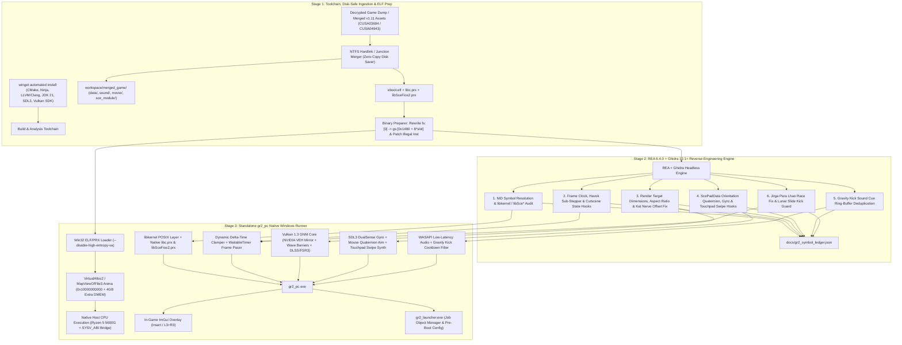

# Gravity Rush 2 Native PC Port (`gr2_pc`) Master Implementation Plan (v2.0 — Argon Architecture)

## 1. Goal Description
Reverse engineer **Gravity Rush 2 (PS4 — CUSA03694 / CUSA04943)** from its decrypted game dump (Base Game + Mandatory Update v1.11 + DLCs), analyze its compiled x86-64 binary (`eboot.bin` / `eboot.elf`) and system modules (`sce_module/*.prx`) using **REA 6.4.0** and **Ghidra 12.1+**, and build a high-performance standalone native Windows 11 PC port (`gr2_pc`).

Modeled on the battle-tested architectures of **`deadinside28/bloodborne_pc` (`bbport`)**, its Windows counterparts **`Supermedo/bloodborne_pc`** and **`FelipePrado0/gow3_pc`**, and the Gravity Rush 2 fixes from **`junminlee2004/GR2fork` (EXODUS)**, this runner executes the original PS4 x86-64 code natively on the host AMD Ryzen 5 5600G CPU, paired with:
- **Zero-Emulation Native Execution + Offline/Load-Time ELF Preparation:** Rewrites Orbis `fs:[0]` TLS accesses to Windows TEB `gs:[0x1480 + 8*slot]`, links native `sce_module/libc.prx` and `libSceFios2.prx`, and bridges the System V AMD64 ABI to Windows x64 via `__attribute__((sysv_abi))`.
- **Win32 Placeholder Virtual Memory & NVIDIA Mirrored VRAM Architecture:** Uses `VirtualAlloc2` and `MapViewOfFile3` at fixed base `0x10000000000ULL` with PS4 Pro (`isPS4Pro = true`) + 4 GB Additional Direct Memory (DMEM), paired with batched VEH page-protection write tracking and a 25% VRAM mirror floor tuned for the **NVIDIA GeForce RTX 4060 Ti**.
- **Vulkan 1.3 GNM/GNMX Shader Translation Core:** Features GCN-to-SPIR-V translation with intra-wave subgroup buffer barriers (for cel-shading outlines and cloth/particle compute), asynchronous linear image readback, two-stage background pipeline compilation, and **NVIDIA DLSS / AMD FSR 3.1 + RCAS**.
- **State-Aware Dynamic $\Delta t$ Physics & Cutscene Pacer:** Supports **60, 120, 144 FPS, and Uncapped** gameplay with high-resolution waitable timer frame pacing, Lunar Style Slide Kick / Jirga Para Lhao race-condition fixes, and automatic 30/60 FPS clamping during comic-book cutscenes and `libSceAvPlayer` movies.
- **Hybrid Input Engine (DualSense Gyro + Xbox Gamepad + Mouse Aim + Synthetic Touchpad Swipes):** Full hardware gyro via SDL3, quaternion-integrated mouse gyro aiming during Gravity Shift, and synthetic touchpad swipe trajectories (`ScePadTouchData`) so Xbox/PC users can seamlessly switch between Normal, Lunar, and Jupiter styles.
- **Hybrid Desktop Companion Launcher + In-Game ImGui Overlay (`Insert` / `L3+R3`):** Real-time control over framerate caps, upscalers, RCAS sharpness, FOV, gyro/mouse sensitivity, and frame-time telemetry.

---

## 2. Architectural Blueprint



---

## 3. Critical Windows & Hardware Engineering Specifications

### 3.1 System V AMD64 to Windows x64 ABI Bridge
* PS4 binaries (`eboot.elf`, `libc.prx`, `libSceFios2.prx`) follow the **System V AMD64 ABI**, whereas Windows 11 uses the **Microsoft x64 ABI**.
* **Mandatory Rule:** Every C++ function exposed in the HLE import table (`libkernel`, `libSceVideoOut`, `libSceGnmDriver`, `libScePad`, `libSceAudioOut`, `libSceSaveData`, `libSceAvPlayer`) and every inline detour target MUST use the macro:
  ```cpp
  #define PS4_SYSV_ABI __attribute__((sysv_abi))
  ```
* All function pointer typedefs pointing into guest memory (e.g., `pthread_create` start routines, `sceFios2` completion callbacks, `atexit` handlers) MUST also be annotated with `PS4_SYSV_ABI`.

### 3.2 Thread-Local Storage (`%fs` to `%gs` TEB Slot Rewriting)
* Orbis OS accesses thread-local variables via `mov rax, fs:[0]`. On 64-bit Windows, `gs` points to the Windows Thread Environment Block (TEB) and cannot be moved.
* At process startup, `gr2_pc` allocates a dedicated Windows TLS slot: `DWORD g_ps4_tcb_slot = TlsAlloc();`.
* In Windows x64, `TEB->TlsSlots[g_ps4_tcb_slot]` is located at `gs:[0x1480 + 8 * g_ps4_tcb_slot]`.
* The ELF loader scans executable sections for the 9-byte instruction `64 48 8B 04 25 00 00 00 00` (`mov rax, fs:[0]`, and variants for `rcx`, `rdx`, `rbx`, `rsi`, `rdi`, `r8–r15`) and patches it in-place to `65 48 8B 04 25 <disp32>` (`mov reg, gs:[0x1480 + 8 * slot]`).
* Each guest thread created via `scePthreadCreate` allocates a fully committed 2 MiB stack (16 MiB for the main thread) and writes its Orbis `tcb*` pointer into `TlsSetValue(g_ps4_tcb_slot, guest_tcb)`.

### 3.3 Memory Virtualization & NVIDIA RTX 4060 Ti VRAM Mirror Model
* **Executable Linker Flags:** `gr2_pc.exe` is compiled with `-Wl,--disable-high-entropy-va` (`HIGHENTROPYVA:NO`) and `-Wl,--image-base,0x140000000` so all host allocations stay below `1 TiB`, leaving `0x10000000000ULL` – `0x11000000000ULL` completely free for the PS4 guest arena.
* **Placeholder Aliasing (`VirtualAlloc2` & `MapViewOfFile3`):**
  - Instead of committing 32 GB upfront, reserve a placeholder arena and back Direct Memory (`DMEM`) with `CreateFileMapping2(INVALID_HANDLE_VALUE, ..., SEC_COMMIT, ...)`.
  - Expose **PS4 Pro Mode (`isPS4Pro = true`) + 4096 MB of Additional DMEM** (total 9.5 GB DMEM budget) so 1440p/4K render targets never trigger out-of-memory faults during Hekseville $\leftrightarrow$ Jirga Para Lhao map transitions.
* **NVIDIA Ada Lovelace (RTX 4060 Ti) Memory Model:**
  - Disable Vulkan sparse buffer binding on NVIDIA GPUs (avoids multi-second driver stalls).
  - Use **In-Place Host Buffers + Mirrored VRAM Copies** with **Batched Page-Protection Write Tracking**:
    1. CPU writes to mirrored GPU pages trigger a `STATUS_ACCESS_VIOLATION` caught by our high-priority Vectored Exception Handler (`AddVectoredExceptionHandler(1, gpu_write_track_veh)`).
    2. The handler unprotects contiguous block runs in a single call, marks the dirty span in a lock-free bitmap, and updates only modified page-table entries on the GPU submission thread.
    3. Enforce a **25% VRAM Mirror Floor** (`GR2_VRAM_MIRROR_FLOOR=25`) so texture streaming never evicts active vertex/constant buffer mirrors.

### 3.4 Vulkan 1.3 Cel-Shading & Compute Pipeline Optimizations
* **Subgroup / Wave Buffer Barriers:** Gravity Rush 2's GCN shaders assume 64-wide wavefronts, whereas the RTX 4060 Ti executes 32-wide warps. The SPIR-V recompiler injects `OpControlBarrier(ScopeSubgroup, ScopeSubgroup, AcquireRelease | UniformMemory)` around intra-wave buffer reads/writes to prevent cel-shading outline corruption and cloth/hair vertex explosions.
* **Asynchronous Linear Image Readback:** Uses a 3-frame staging ring buffer for linear textures (used by GR2's lighting LUTs and Photo Mode), avoiding pipeline stalls while keeping visuals 1:1 with PS4.
* **Kat's Gravity Shift Nerve/Tendril Offset Fix:** Scales the screen-space UV divisor in the gravity-shift post-process shader dynamically with the active internal resolution ($1080\text{p} \rightarrow 1440\text{p} \rightarrow 4\text{K}$).
* **Two-Stage Async Pipeline Compiler:** Background worker threads compile geometry pipelines asynchronously while **blocking on full-screen render passes** (deferred lighting, cel-shading outlines, fog, tonemapping) so frames never flash grey.

### 3.5 State-Aware Dynamic $\Delta t$, Cutscene Clamping, & Crash Guards
* **Dynamic Timestep Formula:**
  $$\Delta t = \text{clamp}\left(\text{measured\_frame\_time}, \frac{1}{240.0}, \frac{1}{30.0}\right)$$
* **Cutscene & Comic-Book Auto-Clamp:** Hooks `sceAvPlayerGetVideoDataEx` and the game's comic-panel UI state flag. When active, the frame pacer automatically clamps to $30.0\text{ FPS}$ (or $60.0\text{ FPS}$ for comic transitions) so audio, subtitles, and QTE timers never desync.
* **High-FPS Stability Guards (120 / 144 / Uncapped):**
  - **Lunar Style Slide Kick Guard:** Prevents division-by-zero / NaN velocity impulse when $\Delta t < 0.0083\text{ s}$ ($>120\text{ FPS}$).
  - **Jirga Para Lhao & Island Streaming Lock Fix:** Replaces the spin-wait asset-loader check with an atomic acquire/release fence + `SwitchToThread()` yield so worker threads don't starve at uncapped framerates.

### 3.6 Hybrid Input: DualSense Gyro, Xbox Mouse Aim, & Touchpad Swipe Synthesizer
* **DualSense / DualShock 4:** Direct SDL3 sensor polling (`SDL_SENSOR_GYRO` + `SDL_SENSOR_ACCEL`) mapped into `ScePadData`.
* **Xbox Controller + PC Mouse Gravity Aiming:**
  - Standard gameplay uses XInput/SDL3 gamepad controls.
  - When Kat enters **Gravity Shift / Aim Mode** (or while Right Mouse Button / Left Trigger is held), raw mouse deltas (`SDL_GetRelativeMouseState`) are converted into angular velocity (`ScePadData.angularVelocity`) **AND** integrated via Hamilton product into `ScePadData.orientation` (`SceFQuaternion`), ensuring smooth, non-snapping reticle control.
* **Synthetic Touchpad Gesture Engine (Style Switching on Xbox/Keyboard):**
  - Gravity Rush 2 requires touchpad swipes to switch gravity styles:
    - **Swipe Up ($Y: 800 \rightarrow 140$ over 8 frames):** Switch to **Lunar Style** (mapped to `LB + D-Pad Up` or Key `1`).
    - **Swipe Down ($Y: 140 \rightarrow 800$ over 8 frames):** Switch to **Jupiter Style** (mapped to `LB + D-Pad Down` or Key `2`).
    - **Touchpad Press / Tap:** Return to **Normal Style** (mapped to `LB + D-Pad Left/Right` or Key `3`).

---

## 4. Detailed Phase-by-Phase Implementation Breakdown

### Phase 1: Toolchain & Dependency Provisioning
Automated `winget` and environment setup script (`scripts/setup_toolchain.ps1`):

```powershell
$ErrorActionPreference = "Stop"

# 1. Install Core C++20 Build System & LLVM/Clang Toolchain
winget install Kitware.CMake --silent --accept-package-agreements --accept-source-agreements
winget install Ninja-build.Ninja --silent --accept-package-agreements --accept-source-agreements
winget install LLVM.LLVM --silent --accept-package-agreements --accept-source-agreements
winget install KhronosGroup.VulkanSDK --silent --accept-package-agreements --accept-source-agreements

# 2. Install OpenJDK 21 for Ghidra 12.1+ Headless Analyzer
winget install Microsoft.OpenJDK.21 --silent --accept-package-agreements --accept-source-agreements

# 3. Verify vcpkg / third-party dependencies (SDL3, ImGui, fmt, spdlog, minhook/zydis, glslang, spirv-cross)
Write-Host "Toolchain provisioning complete. Verifying Clang, Ninja, and Vulkan SDK..."
clang++ --version
ninja --version
```

---

### Phase 2: Disk-Safe Ingestion, Validation & Binary Preparation Pipeline
Because Drive `C:` has ~111 GB of free space, the workspace avoids duplicating multi-gigabyte asset folders by using **NTFS Hard Links (`CreateHardLinkW` / `New-Item -ItemType HardLink`)**.

#### Workspace Directory Layout
```text
C:\Users\faalv\Desktop\Personal project\gravityrush2port\
├── gr2_packages\                 <-- User places decrypted Base + v1.11 Update + DLC dump here
├── REA\                          <-- Local REA 6.4.0 CLI/MCP reverse-engineering engine
└── gr2port\                      <-- Standalone Git Repository (Auto-pushed to GitHub)
    ├── .git\
    ├── .gitignore                <-- Strictly ignores workspace/, build/, dist/game/, *.elf, *.prx
    ├── README.md
    ├── log.md                    <-- Chronological engineering & telemetry log
    ├── gravity_rush_2_pc_port_plan.md
    ├── CMakeLists.txt
    ├── scripts\
    │   ├── setup_toolchain.ps1
    │   ├── prepare_workspace.py  <-- Zero-copy hardlink merger + SHA-256 & v1.11 verifier
    │   └── rea_pipeline.py       <-- Automated REA + Ghidra symbol & hook extractor
    ├── include\
    ├── src\
    ├── gpu\
    ├── ui\
    ├── patches\
    ├── docs\
    │   └── gr2_symbol_ledger.json
    └── workspace\                <-- Git-ignored working directory (Hardlinked, <1 GB extra disk cost)
        └── merged_game\
            ├── eboot.elf         <-- Verified v1.11 x86-64 ELF64 binary
            ├── sce_sys\
            ├── sce_module\       <-- Contains libc.prx, libSceFios2.prx, etc.
            ├── data\
            ├── sound\
            └── movie\
```

#### Automated Preparation & Verification Steps (`scripts/prepare_workspace.py`)
1. **Merge Verification:** Overlay Update v1.11 and DLC files onto the Base Game directory into `workspace/merged_game/` using NTFS hard links for read-only archives (`.par` / `.zar` / `.mp4`) so zero additional disk space is consumed.
2. **Binary Format & Version Check:**
   - Verify `eboot.elf` (or `eboot.bin`) starts with the standard ELF64 magic bytes `7F 45 4C 46 02 01 01` (`ELF64`, little-endian, x86-64).
   - Verify `sce_sys/param.sfo` version string equals **`01.11`** (abort with a clear diagnostic message if base `01.00` is detected, preventing instruction alignment crashes).
   - Verify presence of `sce_module/libc.prx` and `sce_module/libSceFios2.prx`.

---

### Phase 3: Binary Reverse Engineering with REA 6.4.0 & Ghidra 12.1+

Run the automated REA analysis pipeline (`scripts/rea_pipeline.py`) against `workspace/merged_game/eboot.elf`:

#### 1. System API Import & NID Audit
```powershell
rea analyze "workspace/merged_game/eboot.elf" --provider ghidra --json > docs/gr2_raw_analysis.json
```
Map all imported Sony NIDs (64-bit SHA-1 symbol hashes) across:
- **`libkernel`:** `sceKernelAllocateDirectMemory`, `sceKernelMapDirectMemory`, `sceKernelGetDirectMemorySize`, `sceKernelMapFlexibleMemory`, `sceKernelGetTscFrequency`, `sceKernelReadTsc`, `scePthreadCreate`, `scePthreadMutexLock`, `sceKernelCreateEqueue`, `sceKernelWaitEqueue`.
- **`libSceVideoOut`:** `sceVideoOutOpen`, `sceVideoOutSetFlipRate`, `sceVideoOutSubmitFlip`, `sceVideoOutRegisterBuffers`.
- **`libSceGnmDriver`:** `sceGnmSubmitCommandBuffers`, `sceGnmSubmitAndFlipCommandBuffers`, `sceGnmMapComputeQueue`, `sceGnmDingDong`, `sceGnmAreSubmitsAllowed`.
- **`libScePad`:** `scePadOpen`, `scePadReadState`, `scePadRead`, `scePadSetMotionSensorState`, `scePadResetOrientation`, `scePadSetLightBar`.
- **`libSceAudioOut`:** `sceAudioOutOpen`, `sceAudioOutOutput`, `sceAudioOutOutputs`.
- **`libSceSaveData`:** `sceSaveDataInitialize3`, `sceSaveDataMount2`, `sceSaveDataUmount`.
- **`libSceAvPlayer`:** `sceAvPlayerInit`, `sceAvPlayerGetVideoDataEx`, `sceAvPlayerGetAudioData`, `sceAvPlayerIsActive`.

#### 2. Clock, Physics Sub-Stepper & High-FPS Crash Target Discovery
```powershell
rea xrefs "workspace/merged_game/eboot.elf" "sceVideoOutSetFlipRate" --provider ghidra --json
rea search-scalars "workspace/merged_game/eboot.elf" --value 0x3D088889 --json # 0.033333335f (1/30.0f)
```
- Decompile the main game loop and physics step functions:
  ```powershell
  rea decompile "workspace/merged_game/eboot.elf" <frame_step_addr> --provider ghidra --json
  ```
- Extract exact RVA offsets for:
  1. `rva_frame_delta_time` (the hardcoded $1/30.0\text{ s}$ `0x3D088889` float load).
  2. `rva_physics_substep_clamp` (cloth/hair and gravity velocity integrator).
  3. `rva_lunar_slide_kick_impulse` (clamping minimum divisor when $\Delta t < 1/120.0\text{ s}$).
  4. `rva_island_streaming_spinlock` (Jirga Para Lhao asset streaming synchronization loop).
  5. `rva_cutscene_comic_state_flag` (boolean state flag indicating active comic panel or scripted cutscene).

#### 3. Resolution, Aspect Ratio & Kat's Nerve Shader Uniform Discovery
```powershell
rea search-scalars "workspace/merged_game/eboot.elf" --value 1920 --context 1080 --json
rea search-scalars "workspace/merged_game/eboot.elf" --value 0x3FE38E39 --json # 1.7777778f (16:9 aspect)
```
- Extract RVAs for internal G-buffer allocation dimensions, camera frustum aspect ratio ($16:9 \rightarrow 21:9 / 32:9$), HUD safe-zone scaling, and the screen-space UV divisor for Kat's gravity-shift nerve tendrils.

#### 4. Motion Gyro, Orientation Quaternion & Touchpad Swipe Tracing
```powershell
rea xrefs "workspace/merged_game/eboot.elf" "scePadReadState" --provider ghidra --json
```
- Trace how `ScePadData` offsets (`0x10` orientation quaternion, `0x20` acceleration, `0x2C` angular velocity, `0x44` touch data) feed into Kat's camera controller and style-switching state machine.

#### 5. Audio Gravity Kick Trigger Trace
```powershell
rea xrefs "workspace/merged_game/eboot.elf" "sceAudioOutOutputs" --provider ghidra --json
```
- Identify the voice submission path and PCM ring-buffer mixer so `gr2_audio.cpp` can deduplicate repeated Gravity Kick impact cues within a configurable $45\text{ ms}$ cooldown window.

#### 6. Export Modding & Symbol Ledger
- Write all verified RVAs, byte signatures, original instruction bytes, and function prototypes into `docs/gr2_symbol_ledger.json`.

---

## 5. Standalone PC Runner Architecture (`gr2_pc`)

### Repository File Structure
```text
gr2port/
├── CMakeLists.txt
├── app.manifest                    # Enables UTF-8 codepage & LongPathAware on Windows 11
├── include/
│   ├── gr2_abi.h                   # PS4_SYSV_ABI macros, NID hashes, Orbis struct definitions
│   ├── gr2_config.h                # INI/JSON settings & atomic runtime toggles
│   ├── gr2_memory.h                # VirtualAlloc2 arena, DMEM aliasing & VEH write tracker
│   ├── gr2_loader.h                # ELF64/PRX loader, TLS fs->gs rewriter & relocator
│   ├── gr2_kernel.h                # libkernel POSIX threads, equeues, HighRes timers, FS
│   ├── gr2_hooks.h                 # Dynamic dt, Lunar kick guard, resolution & aspect hooks
│   ├── gr2_pad.h                   # DualSense gyro, Xbox mouse quaternion aim, swipe synth
│   ├── gr2_audio.h                 # WASAPI low-latency backend & Gravity Kick deduplicator
│   └── gr2_overlay.h               # ImGui overlay & telemetry graphs
├── src/
│   ├── main.cpp                    # Entry point, VEH registration, TLS init, guest launch
│   ├── gr2_memory.cpp              # Placeholder memory manager & NVIDIA VRAM dirty bitmap
│   ├── gr2_loader.cpp              # ELF/PRX parser, NID resolver & TLS instruction rewriter
│   ├── gr2_kernel.cpp              # libkernel stubs + native libc.prx / libSceFios2.prx bridge
│   ├── gr2_hooks.cpp               # Frame pacer, dt scaling, cutscene clamp, crash hotfixes
│   ├── gr2_pad.cpp                 # SDL3 gamepad + mouse aim + touchpad gesture state machine
│   ├── gr2_audio.cpp               # WASAPI renderer + sound cue hash cooldown filter
│   └── gr2_config.cpp              # Persistent configuration loader/saver
├── gpu/
│   ├── CMakeLists.txt
│   ├── vulkan_backend.cpp          # Vulkan 1.3 device, swapchain, async pipeline workers
│   ├── gnm_cmd_processor.cpp       # Two-stage PM4 command processor & GPU fence writer
│   ├── gnm_shader_recompiler.cpp   # GCN to SPIR-V with intra-wave subgroup buffer barriers
│   ├── texture_cache.cpp           # Mirrored VRAM cache with 25% floor & async linear readback
│   └── upscalers.cpp               # NVIDIA DLSS / AMD FSR 3.1 / TAA + RCAS sharpening pass
├── ui/
│   ├── imgui_overlay.cpp           # In-game overlay (Insert / L3+R3) with 0.4s slider debounce
│   └── launcher_gui.cpp            # Standalone gr2_launcher.exe with Win32 Job Object control
└── patches/
    └── CUSA03694_v01.11.xml        # Signature-verified memory patches (FPS, Res, Ultrawide, Fixes)
```

---

### Core Production Code Implementations

#### A. ABI Macros & Windows TLS Rewriter (`include/gr2_abi.h` & `src/gr2_loader.cpp`)
```cpp
// include/gr2_abi.h
#pragma once
#include <cstdint>

#if defined(__clang__) || defined(__GNUC__)
    #define PS4_SYSV_ABI __attribute__((sysv_abi))
#else
    #error "gr2_pc must be compiled with Clang/LLVM to support __attribute__((sysv_abi)) on Windows."
#endif

// Rewrite 9-byte `mov reg, fs:[0]` (64 48 8B XX 25 00 00 00 00)
// to 9-byte `mov reg, gs:[0x1480 + 8 * tls_slot]` (65 48 8B XX 25 <disp32>)
inline void rewrite_fs_tls_instructions(uint8_t* code, size_t size, uint32_t tls_slot) {
    const uint32_t teb_tls_offset = 0x1480u + (tls_slot * 8u);
    for (size_t i = 0; i + 9 <= size; ++i) {
        if (code[i] == 0x64 && (code[i + 1] == 0x48 || code[i + 1] == 0x4C) &&
            code[i + 2] == 0x8B && (code[i + 3] & 0xC7) == 0x04 &&
            code[i + 4] == 0x25 &&
            *reinterpret_cast<const uint32_t*>(&code[i + 5]) == 0x00000000u) {
            code[i] = 0x65; // Replace FS prefix (0x64) with GS prefix (0x65)
            *reinterpret_cast<uint32_t*>(&code[i + 5]) = teb_tls_offset;
            i += 8;
        }
    }
}
```

#### B. Win32 Placeholder Virtual Memory & Extra DMEM (`src/gr2_memory.cpp`)
```cpp
#include <windows.h>
#include <memoryapi.h>
#include <cstdint>
#include <stdexcept>

#pragma comment(lib, "mincore.lib")

constexpr uintptr_t PS4_ARENA_BASE = 0x10000000000ULL;
constexpr size_t    PS4_ARENA_SIZE = 0x1000000000ULL; // 64 GB virtual reservation window
constexpr size_t    PS4_BASE_DMEM  = 5632ULL * 1024 * 1024; // 5.5 GB Pro Base
constexpr size_t    PS4_EXTRA_DMEM = 4096ULL * 1024 * 1024; // +4 GB Extra DMEM for 4K/8K Render Targets

struct Ps4MemoryManager {
    HANDLE dmem_section = nullptr;
    void*  arena_base   = nullptr;

    void initialize() {
        // Reserve virtual address space with placeholders so sub-ranges can be split & aliased
        arena_base = VirtualAlloc2(
            GetCurrentProcess(),
            reinterpret_cast<void*>(PS4_ARENA_BASE),
            PS4_ARENA_SIZE,
            MEM_RESERVE | MEM_RESERVE_PLACEHOLDER,
            PAGE_NOACCESS,
            nullptr, 0
        );
        if (!arena_base) {
            throw std::runtime_error("VirtualAlloc2 failed to reserve PS4 arena at 0x10000000000");
        }

        // Create backing pagefile section for Direct Memory (DMEM)
        const size_t total_dmem = PS4_BASE_DMEM + PS4_EXTRA_DMEM;
        dmem_section = CreateFileMapping2(
            INVALID_HANDLE_VALUE, nullptr,
            FILE_MAP_ALL_ACCESS | FILE_MAP_EXECUTE,
            PAGE_EXECUTE_READWRITE,
            SEC_COMMIT, total_dmem, nullptr, nullptr, 0
        );
        if (!dmem_section) {
            throw std::runtime_error("CreateFileMapping2 failed for DMEM backing store");
        }
    }

    // Commit a guest ELF/Flexible segment inside the reserved placeholder arena
    void* map_flexible_memory(uintptr_t guest_addr, size_t size, DWORD prot = PAGE_EXECUTE_READWRITE) {
        VirtualFreeEx(GetCurrentProcess(), reinterpret_cast<void*>(guest_addr), size,
                      MEM_RELEASE | MEM_PRESERVE_PLACEHOLDER);
        return VirtualAlloc2(
            GetCurrentProcess(), reinterpret_cast<void*>(guest_addr), size,
            MEM_RESERVE | MEM_COMMIT | MEM_REPLACE_PLACEHOLDER,
            prot, nullptr, 0
        );
    }

    // Alias physical DMEM offset into virtual address space (supports CPU + GPU double mapping)
    void* map_direct_memory(uintptr_t guest_addr, size_t size, uint64_t phys_offset, DWORD prot = PAGE_READWRITE) {
        VirtualFreeEx(GetCurrentProcess(), reinterpret_cast<void*>(guest_addr), size,
                      MEM_RELEASE | MEM_PRESERVE_PLACEHOLDER);
        return MapViewOfFile3(
            dmem_section, GetCurrentProcess(),
            reinterpret_cast<void*>(guest_addr),
            phys_offset, size,
            MEM_REPLACE_PLACEHOLDER, prot, nullptr, 0
        );
    }
};

extern "C" size_t PS4_SYSV_ABI sceKernelGetDirectMemorySize() {
    return PS4_BASE_DMEM + PS4_EXTRA_DMEM;
}
```

#### C. State-Aware Dynamic Delta-Time, Cutscene Clamper & High-Res Frame Pacer (`src/gr2_hooks.cpp`)
```cpp
#include "gr2_abi.h"
#include <windows.h>
#include <algorithm>
#include <atomic>
#include <cmath>

static std::atomic<float> g_target_fps{120.0f}; // 60, 120, 144, or 0 (Uncapped)
static std::atomic<bool>  g_in_cutscene_or_comic{false};
static HANDLE             g_waitable_timer = nullptr;
static LARGE_INTEGER      g_qpc_freq{};
static LARGE_INTEGER      g_last_frame_qpc{};

void init_frame_pacer() {
    QueryPerformanceFrequency(&g_qpc_freq);
    QueryPerformanceCounter(&g_last_frame_qpc);
    g_waitable_timer = CreateWaitableTimerExW(
        nullptr, nullptr,
        CREATE_WAITABLE_TIMER_MANUAL_RESET | CREATE_WAITABLE_TIMER_HIGH_RESOLUTION,
        TIMER_ALL_ACCESS
    );
}

// Called at every frame flip (sceVideoOutSubmitFlip / sceGnmSubmitAndFlipCommandBuffers)
extern "C" float PS4_SYSV_ABI hook_compute_frame_delta_time() {
    LARGE_INTEGER now{};
    QueryPerformanceCounter(&now);
    double elapsed = static_cast<double>(now.QuadPart - g_last_frame_qpc.QuadPart) /
                     static_cast<double>(g_qpc_freq.QuadPart);

    // Determine effective FPS cap (force 60 FPS cap during comic-book or video cutscenes)
    float target_fps = g_in_cutscene_or_comic.load(std::memory_order_relaxed)
                           ? 60.0f
                           : g_target_fps.load(std::memory_order_relaxed);

    if (target_fps > 0.0f) {
        const double target_frame_time = 1.0 / static_cast<double>(target_fps);
        if (elapsed < target_frame_time) {
            const double remaining = target_frame_time - elapsed;
            if (remaining > 0.0015 && g_waitable_timer) {
                LARGE_INTEGER due{};
                due.QuadPart = -static_cast<LONGLONG>((remaining - 0.0008) * 10000000.0);
                SetWaitableTimerEx(g_waitable_timer, &due, 0, nullptr, nullptr, nullptr, 0);
                WaitForSingleObject(g_waitable_timer, INFINITE);
            }
            // Spin-wait final sub-millisecond for microsecond-accurate frame pacing
            do {
                YieldProcessor();
                QueryPerformanceCounter(&now);
                elapsed = static_cast<double>(now.QuadPart - g_last_frame_qpc.QuadPart) /
                          static_cast<double>(g_qpc_freq.QuadPart);
            } while (elapsed < target_frame_time);
        }
    }

    g_last_frame_qpc = now;

    // Clamp dt to [1/240s, 1/30s] to prevent Lunar Style Slide Kick NaN and physics explosions
    float clamped_dt = static_cast<float>(std::clamp(elapsed, 1.0 / 240.0, 1.0 / 30.0));
    return clamped_dt;
}
```

#### D. Hybrid Input: DualSense Gyro + Mouse Quaternion Aim + Synthetic Touchpad Swipes (`src/gr2_pad.cpp`)
```cpp
#include "gr2_abi.h"
#include <SDL3/SDL.h>
#include <cmath>
#include <cstring>

struct SceFQuaternion { float x, y, z, w; };
struct SceFVector3    { float x, y, z; };

struct ScePadTouch {
    uint16_t x;  // 0..1919
    uint16_t y;  // 0..941
    uint8_t  id;
    uint8_t  reserve[3];
};

struct ScePadTouchData {
    uint8_t     touchNum;
    uint8_t     reserve[3];
    uint32_t    reserve1;
    ScePadTouch touch[2];
};

struct ScePadData {
    uint32_t        buttons;
    uint8_t         leftStickX, leftStickY;
    uint8_t         rightStickX, rightStickY;
    uint8_t         analogButtons[2];
    uint8_t         padding[2];
    SceFQuaternion  orientation;
    SceFVector3     acceleration;
    SceFVector3     angularVelocity;
    ScePadTouchData touchData;
    bool            connected;
    uint8_t          padding2[7];
    uint64_t        timestamp;
};

static SceFQuaternion g_virtual_orientation = {0.0f, 0.0f, 0.0f, 1.0f};

// Synthesize 8-frame touchpad swipe for switching Lunar (Up) and Jupiter (Down) Styles
struct TouchSwipeSynthesizer {
    int      frames_remaining = 0;
    uint16_t start_y = 470, end_y = 470;
    uint8_t  touch_id = 1;

    void trigger_swipe(bool swipe_up) {
        frames_remaining = 8;
        start_y = swipe_up ? 800 : 140;
        end_y   = swipe_up ? 140 : 800;
        touch_id = (touch_id + 1) & 0x7F;
    }

    void step(ScePadTouchData& out) {
        if (frames_remaining <= 0) {
            out.touchNum = 0;
            return;
        }
        float t = 1.0f - (static_cast<float>(frames_remaining - 1) / 7.0f);
        out.touchNum = 1;
        out.touch[0].id = touch_id;
        out.touch[0].x  = 960;
        out.touch[0].y  = static_cast<uint16_t>(start_y + t * (end_y - start_y));
        --frames_remaining;
    }
} g_swipe_synth;

// Update orientation quaternion from angular velocity (rad/s) over dt
inline void integrate_quaternion(SceFQuaternion& q, float gx, float gy, float gz, float dt) {
    float hx = 0.5f * gx * dt;
    float hy = 0.5f * gy * dt;
    float hz = 0.5f * gz * dt;
    SceFQuaternion dq = {
         hx * q.w + hy * q.z - hz * q.y,
        -hx * q.z + hy * q.w + hz * q.x,
         hx * q.y - hy * q.x + hz * q.w,
        -hx * q.x - hy * q.y - hz * q.z
    };
    q.x += dq.x; q.y += dq.y; q.z += dq.z; q.w += dq.w;
    float norm = std::sqrt(q.x*q.x + q.y*q.y + q.z*q.z + q.w*q.w);
    if (norm > 1e-6f) { q.x /= norm; q.y /= norm; q.z /= norm; q.w /= norm; }
}

extern "C" int PS4_SYSV_ABI scePadReadState(int32_t handle, ScePadData* data) {
    if (!data) return -1;
    std::memset(data, 0, sizeof(ScePadData));
    data->connected = true;
    data->leftStickX = 128; data->leftStickY = 128;
    data->rightStickX = 128; data->rightStickY = 128;
    data->acceleration = {0.0f, -1.0f, 0.0f};

    // Poll mouse delta for Xbox/PC Gravity Shift aiming
    float mdx = 0.0f, mdy = 0.0f;
    SDL_GetRelativeMouseState(&mdx, &mdy);
    constexpr float sens = 0.0035f;
    float gx = -mdy * sens;
    float gy = -mdx * sens;

    data->angularVelocity = {gx, gy, 0.0f};
    integrate_quaternion(g_virtual_orientation, gx, gy, 0.0f, 1.0f / 60.0f);
    data->orientation = g_virtual_orientation;

    // Synthesize Touchpad Swipes for Lunar / Jupiter Style switching
    g_swipe_synth.step(data->touchData);
    data->timestamp = SDL_GetTicksNS() / 1000;
    return 0;
}
```

#### E. Audio Gravity Kick Deduplication Filter (`src/gr2_audio.cpp`)
```cpp
#include "gr2_abi.h"
#include <unordered_map>
#include <chrono>
#include <cstdint>

static std::unordered_map<uint64_t, std::chrono::steady_clock::time_point> g_cue_history;
constexpr auto KICK_DEDUP_COOLDOWN = std::chrono::milliseconds(45);

// FNV-1a hash of the initial 64 PCM samples to detect duplicate simultaneous Gravity Kick triggers
inline uint64_t hash_audio_frame(const int16_t* pcm, size_t sample_count) {
    uint64_t hash = 14695981039346656037ULL;
    size_t n = (sample_count < 64) ? sample_count : 64;
    for (size_t i = 0; i < n; ++i) {
        hash ^= static_cast<uint16_t>(pcm[i]);
        hash *= 1099511628211ULL;
    }
    return hash;
}

bool should_suppress_duplicate_kick_cue(const int16_t* pcm_buffer, size_t samples) {
    if (!pcm_buffer || samples == 0) return false;
    uint64_t sig = hash_audio_frame(pcm_buffer, samples);
    if (sig == 14695981039346656037ULL) return false; // Ignore silence

    auto now = std::chrono::steady_clock::now();
    auto it = g_cue_history.find(sig);
    if (it != g_cue_history.end() && (now - it->second) < KICK_DEDUP_COOLDOWN) {
        return true; // Suppress overlapping duplicate trigger
    }
    g_cue_history[sig] = now;
    return false;
}
```

---

## 6. Build & Packaging Pipeline (Phase 5)

### Root `CMakeLists.txt` Configuration
```cmake
cmake_minimum_required(VERSION 3.25)
project(gr2_pc VERSION 2.0.0 LANGUAGES C CXX)

set(CMAKE_CXX_STANDARD 20)
set(CMAKE_CXX_STANDARD_REQUIRED ON)

# Crucial Windows flags for Orbis 64-bit flat address space compatibility
if(WIN32)
    add_compile_definitions(WIN32_LEAN_AND_MEAN NOMINMAX _CRT_SECURE_NO_WARNINGS)
    add_link_options(
        "-Wl,--disable-high-entropy-va"
        "-Wl,--image-base,0x140000000"
        "-Wl,--stack,16777216,16777216" # 16 MiB fully committed main thread stack
    )
endif()

find_package(Vulkan REQUIRED)
find_package(SDL3 REQUIRED)

add_library(gr2_core STATIC
    src/gr2_memory.cpp
    src/gr2_loader.cpp
    src/gr2_kernel.cpp
    src/gr2_hooks.cpp
    src/gr2_pad.cpp
    src/gr2_audio.cpp
    src/gr2_config.cpp
)
target_include_directories(gr2_core PUBLIC include)
target_link_libraries(gr2_core PUBLIC SDL3::SDL3 mincore onecore winmm ole32 mmdevapi)

add_subdirectory(gpu)

add_executable(gr2_pc src/main.cpp ui/imgui_overlay.cpp app.manifest)
target_link_libraries(gr2_pc PRIVATE gr2_core gr2_gpu Vulkan::Vulkan)

add_executable(gr2_launcher WIN32 ui/launcher_gui.cpp app.manifest)
```

### Build & Zero-Copy Distribution Assembly
```powershell
# 1. Configure & Compile Release Binaries with Clang + Ninja
cmake -B build -G "Ninja" -DCMAKE_BUILD_TYPE=Release -DCMAKE_C_COMPILER=clang -DCMAKE_CXX_COMPILER=clang++
cmake --build build --parallel

# 2. Assemble dist/ Directory using NTFS Junctions for game/ (0 GB extra disk space)
New-Item -ItemType Directory -Force -Path "dist\shaders", "dist\patches"
Copy-Item "build\gr2_pc.exe", "build\gr2_launcher.exe" -Destination "dist\"
Copy-Item "patches\*" -Destination "dist\patches\"
cmd /c mklink /J "dist\game" "workspace\merged_game"
```

---

## 7. Verification & Testing Matrix (Phase 6)

### Automated Pre-Flight Verification Suite (`ctest`)
- [ ] **Check 1 — Address Space & High-Entropy VA Check:** Verify `gr2_pc.exe` PE header clears `IMAGE_DLLCHARACTERISTICS_HIGH_ENTROPY_VA` and successfully reserves `0x10000000000ULL` via `VirtualAlloc2` + `4096 MB` Extra DMEM via `CreateFileMapping2`.
- [ ] **Check 2 — TLS Instruction Rewriter Test:** Verify 100% of `mov reg, fs:[0]` instructions in `eboot.elf`, `libc.prx`, and `libSceFios2.prx` are rewritten to `mov reg, gs:[0x1480 + 8*slot]` with zero residual raw `fs:[0]` reads.
- [ ] **Check 3 — SYSV_ABI Calling Convention Smoke Test:** Call every registered `libkernel` and `libSce*` stub from a synthetic System V AMD64 assembly harness verifying `rdi, rsi, rdx, rcx, r8, r9` and `xmm6–xmm15` preservation.
- [ ] **Check 4 — Patch Signature Verification:** Validate SHA-256 and original byte signatures at all patch offsets in `patches/CUSA03694_v01.11.xml` against `workspace/merged_game/eboot.elf`.
- [ ] **Check 5 — Vulkan Subgroup Barrier & NVIDIA Pipeline Cache Check:** Compile Gravity Rush 2's cel-shading outline and cloth compute shaders to SPIR-V and validate with `spirv-val --target-env vulkan1.3`.

### Manual In-Game Verification Protocol
1. **Launcher & Job Object Boot:** Launch `gr2_launcher.exe`, select **1440p**, **120 FPS**, **DLSS Quality**, click **Play** $\rightarrow$ Verify `gr2_pc.exe` initializes the Vulkan 1.3 swapchain on the RTX 4060 Ti.
2. **Comic-Book Cutscene & Movie Pacing:** Start a New Game or replay a Story Episode $\rightarrow$ Verify pre-rendered intro movies and comic-book speech panels auto-clamp to 30/60 FPS with zero audio desync.
3. **Style Switching & Mouse Gyro Aiming:**
   - Press `LB + D-Pad Up` (or Key `1`) $\rightarrow$ Confirm synthetic touchpad swipe switches Kat to **Lunar Style**.
   - Press `LB + D-Pad Down` (or Key `2`) $\rightarrow$ Confirm switch to **Jupiter Style**.
   - Enter **Gravity Shift** and move the PC mouse $\rightarrow$ Confirm smooth quaternion-integrated reticle aiming with no snap-back.
4. **High-Framerate & Lunar Slide Kick Stress Test:** Toggle ImGui overlay (`Insert`), set framerate to **144 FPS** and **Uncapped**, perform 10 consecutive **Lunar Style Slide Kicks** and **Gravity Kicks** $\rightarrow$ Verify zero NaN crashes and zero overlapping/looping kick audio.
5. **City Transition & VRAM Stability Test:** Fly from **Jirga Para Lhao** across islands and transition to **Hekseville** at **4K internal resolution** $\rightarrow$ Confirm VRAM usage stays within the RTX 4060 Ti budget with no driver resets (`VK_ERROR_DEVICE_LOST`) or infinite loading screens.
